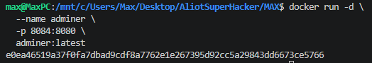
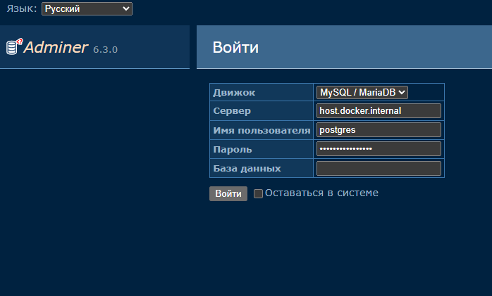
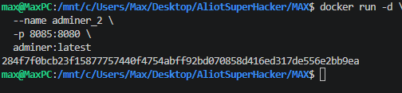
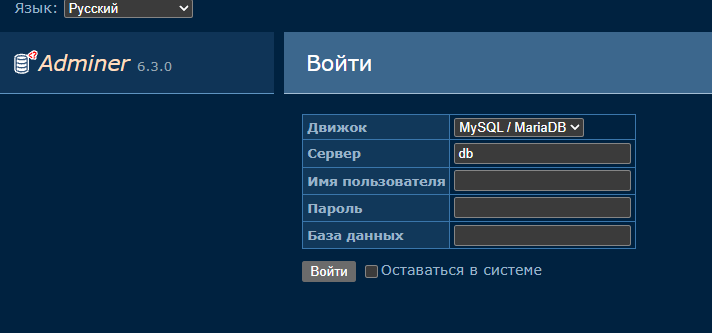

# Adminer — управление базами данных

**Adminer** — это веб-инструмент для управления базами данных. Он является альтернативой phpMyAdmin.

В этой практической работе мы запустим Adminer с помощью Docker и откроем его в браузере.

## Содержание

1. [Подготовка](#1-подготовка)
2. [Запуск Adminer в Windows PowerShell](#2-запуск-adminer-в-windows-powershell)
3. [Проверка работы](#3-проверка-работы)
4. [Создание второго контейнера](#4-создание-второго-контейнера)
5. [Подключение к PostgreSQL](#5-подключение-к-postgresql)

---

## 1. Подготовка

Перед началом работы обратите внимание на несколько правил:

> Никогда в разработке не используйте русские имена файлов и каталогов!

> Никогда в разработке не используйте пробелы и специальные символы в именах файлов и каталогов!

> Перед созданием проекта убедитесь, что порт **8084** не занят другим приложением!

> Создание проекта лучше начать с чистого листа, предварительно остановив и удалив другие контейнеры и образы!

---

## 2. Запуск Adminer в Windows PowerShell

Откройте **Windows PowerShell** и выполните команду:

```powershell
docker run -d `
  --name adminer `
  -p 8084:8080 `
  adminer:latest
```

**Скриншот 1 — запуск контейнера Adminer**



## 3. Проверка работы

После запуска контейнера откройте браузер и перейдите по адресу:

**http://localhost:8084**



Если всё сделано правильно, откроется страница входа Adminer.

## 4. Создание второго контейнера

При необходимости из того же Docker-образа можно создать ещё один контейнер.

Выполните команду:

```bash
docker run -d \
  --name adminer_2 \
  -p 8085:8080 \
  adminer:latest
```

**Скриншот 3 — создание второго контейнера**



Теперь откройте второй экземпляр Adminer:

**http://localhost:8085**



## 5. Подключение к PostgreSQL

> Важно! Без отдельно запущенного контейнера с базой данных PostgreSQL и связи с ним админ-панель работать не будет!

Для подключения используются следующие данные:

| Параметр | Значение |
|---|---|
| Система | PostgreSQL |
| Сервер | `host.docker.internal` |
| Логин | `postgres` |
| Пароль | `mysecretpassword` |

**Скриншот 5 — данные для подключения к PostgreSQL**


> Заполнять данные админ-панели не нужно!

---

## Дополнительная информация

Если вы обнаружили ошибку в этом тексте, пожалуйста, сообщите об этом автору.