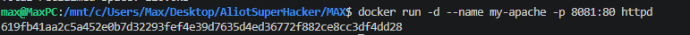
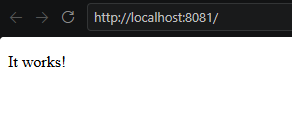
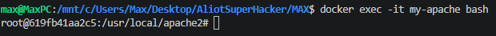
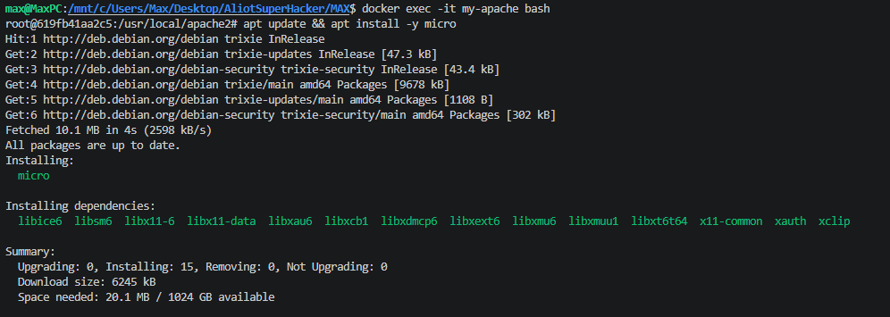
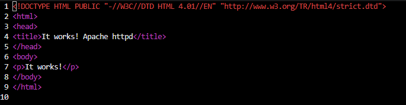
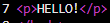
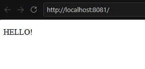
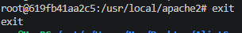

# 🌐 Apache + Docker

### Практическая работа по развёртыванию и редактированию веб-сервера Apache в Docker

---

> **Apache HTTP Server** — популярный веб-сервер с открытым исходным кодом, предназначенный для обработки HTTP-запросов и размещения веб-сайтов.

> [!IMPORTANT]
> ### Правила работы
> - Никогда не используйте русские имена файлов и каталогов.
> - Не используйте пробелы и специальные символы в именах файлов и каталогов.
> - Создание проекта рекомендуется начинать с чистого листа, предварительно остановив и удалив ненужные контейнеры и образы.

---

## 📑 Содержание

1. [Получение образа и запуск контейнера](#1-получение-образа-и-запуск-контейнера)
2. [Редактирование веб-страницы](#2-редактирование-веб-страницы)
   - [Подключение к контейнеру](#21-подключение-к-контейнеру)
   - [Установка текстового редактора](#22-установка-текстового-редактора)
   - [Редактирование indexhtml](#23-редактирование-indexhtml)
3. [Проверка результата](#3-проверка-результата)
4. [Выход из контейнера](#4-выход-из-контейнера)

---

# 1. Получение образа и запуск контейнера

Для начала необходимо получить готовый образ Apache, создать контейнер и запустить веб-сервер.

Выполните команду:

```bash
docker run -d --name my-apache -p 8081:80 httpd
```

**Результат выполнения:**



### Проверка работы сервера

После запуска контейнера откройте веб-страницу в браузере:

🌐 [http://localhost:8081](http://localhost:8081)

**Результат:**



---

# 2. Редактирование веб-страницы

Теперь изменим стандартную страницу Apache, чтобы вместо неё отображался собственный текст.

## 2.1. Подключение к контейнеру

Для начала необходимо войти внутрь запущенного контейнера.

Выполните команду:

```bash
docker exec -it my-apache bash
```

**Результат выполнения:**



## 2.2. Установка текстового редактора

Для редактирования HTML-файла установим текстовый редактор командной строки **Micro**.

Выполните команду:

```bash
apt update && apt install -y micro
```

**Результат выполнения:**



## 2.3. Редактирование index.html

Теперь откроем основной HTML-файл веб-страницы Apache.

Выполните команду:

```bash
micro /usr/local/apache2/htdocs/index.html
```

**Результат выполнения:**



### Настройка кодировки

> [!NOTE]
> Чтобы на веб-странице корректно отображался русский язык, необходимо добавить следующий HTML-тег:
>
> ```html
> <meta charset="UTF-8">
> ```

Отредактируйте содержимое страницы и сохраните изменения с помощью **Ctrl + S**.

Для выхода из режима редактирования используйте **Ctrl + Q** или **F10**.

**Результат редактирования:**



---

# 3. Проверка результата

После сохранения изменений необходимо проверить работу обновлённой веб-страницы.

Откройте браузер и перейдите по адресу:

🌐 [http://localhost:8081](http://localhost:8081)

**Результат:**



---

# 4. Выход из контейнера

После завершения работы необходимо выйти из контейнера.

Выполните команду:

```bash
exit
```

**Результат выполнения:**



---

## 📝 Итоги практической работы

В ходе выполнения практической работы были рассмотрены:

- Получение готового образа Apache.
- Создание и запуск Docker-контейнера.
- Проверка работы веб-сервера через браузер.
- Подключение к работающему контейнеру.
- Установка текстового редактора Micro.
- Редактирование HTML-страницы.
- Настройка кодировки UTF-8.
- Проверка изменений в браузере.

---

> [!TIP]
> Если вы обнаружили ошибку в данном конспекте, пожалуйста, сообщите об этом автору!