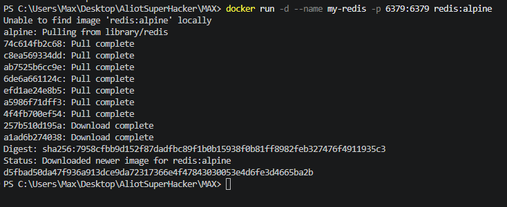
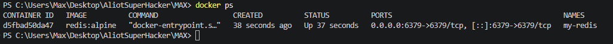
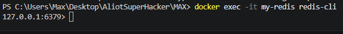

# Redis — база данных

**Redis** — это система управления базами данных, которая хранит данные в оперативной памяти. Она часто используется для кеширования, хранения временных данных и быстрого доступа к информации.

В этой практической работе мы получим Docker-образ Redis, создадим контейнер и подключимся к нему через Redis CLI.

> Для выполнения задания используйте WSL (Ubuntu), Linux или macOS.

## Содержание

1. [Подготовка Docker](#1-подготовка-docker)
2. [Создание и запуск Redis](#2-создание-и-запуск-redis)
3. [Подключение к Redis CLI](#3-подключение-к-redis-cli)
4. [Результат работы](#4-результат-работы)

---

## 1. Подготовка Docker

Перед началом работы рекомендуется проверить состояние Docker и освободить ненужные ресурсы.

> Важно! Команды очистки могут удалить контейнеры и данные других проектов. Не выполняйте их без необходимости.

### Шаг 1. Остановка запущенных контейнеров

Выполните:

```bash
docker stop $(docker ps -q)
```

Команда остановит все запущенные контейнеры.

### Шаг 2. Удаление остановленных контейнеров

Выполните:

```bash
docker container prune
```

Подтвердите удаление, введя `y`.

> Prune — механизм очистки Docker от ненужных ресурсов.

### Альтернативный способ удаления контейнеров

Можно принудительно удалить все контейнеры, включая запущенные:

```bash
docker rm -f $(docker ps -aq)
```

Используйте эту команду только при уверенности, что остальные контейнеры вам больше не нужны.

### Шаг 3. Очистка Docker Volumes

При необходимости удалите неиспользуемые тома:

```bash
docker volume prune -a
```

### Шаг 4. Удаление ненужных образов

Опционально можно удалить неиспользуемые Docker-образы:

```bash
docker image prune -a
```
### Шаг 5. Очистка кеша сборок

Выполните:

```bash
docker builder prune -a
```
Дополнительная информация: [Шпаргалка по управлению Docker](../DockerReminder.md).

---

## 2. Создание и запуск Redis

Перед запуском убедитесь, что порт **6379** не занят другим приложением.

### Шаг 1. Получение образа и создание контейнера

Откройте терминал WSL (Ubuntu) и выполните:

```bash
docker run -d --name my-redis -p 6379:6379 redis:alpine
```

Разберём команду:

- `docker run` — создание и запуск контейнера.
- `-d` — запуск в фоновом режиме.
- `--name my-redis` — имя контейнера.
- `-p 6379:6379` — подключение порта компьютера к порту контейнера.
- `redis:alpine` — Docker-образ Redis на базе Alpine Linux.

**Скриншот 6 — создание и запуск Redis**



### Шаг 2. Проверка контейнера

Чтобы убедиться, что Redis запущен, выполните:

```bash
docker ps
```

В списке должен появиться контейнер `my-redis`.

**Скриншот 7 — проверка запущенного контейнера**



---

## 3. Подключение к Redis CLI

Теперь подключимся к командной оболочке Redis.

### Шаг 1. Запуск Redis CLI

Выполните:

```bash
docker exec -it my-redis redis-cli
```

Разберём команду:

- `docker exec` — выполнение команды внутри работающего контейнера.
- `-it` — интерактивный режим терминала.
- `my-redis` — имя нашего контейнера.
- `redis-cli` — командная оболочка для взаимодействия с Redis.

**Скриншот 8 — подключение к Redis CLI**



Если всё выполнено правильно, появится приглашение командной строки Redis:

```text
127.0.0.1:6379>
```

Теперь вы подключены к Redis.

---

## 4. Результат работы

В ходе практической работы мы:

- Подготовили Docker к работе.
- Получили Docker-образ Redis.
- Создали и запустили контейнер `my-redis`.
- Проверили состояние контейнера.
- Подключились к Redis CLI.

> Если вы обнаружили ошибку в этом тексте, пожалуйста, сообщите об этом автору!