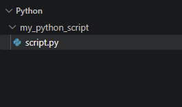
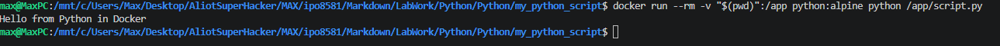
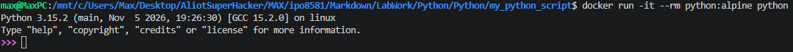
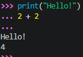

# Python в Docker

В этой практической работе мы научимся запускать Python-скрипты внутри Docker-контейнера, не устанавливая Python непосредственно на компьютер.

Для выполнения задания используйте **WSL (Ubuntu)** или любую другую Linux-систему либо macOS.

## Содержание

1. [Подготовка Docker](#1-подготовка-docker)
2. [Создание Python-проекта](#2-создание-python-проекта)
3. [Запуск Python-скрипта](#3-запуск-python-скрипта)
4. [Интерактивный Python](#4-интерактивный-python)
5. [Результат работы](#5-результат-работы)

---

## 1. Подготовка Docker

Перед началом работы рекомендуется завершить и удалить ненужные учебные контейнеры.

> Важно! Команды очистки могут удалить данные других проектов. Не выполняйте их без необходимости, особенно если в Docker есть важные контейнеры или тома.

### Шаг 1. Остановка запущенных контейнеров

Выполните:

```bash
docker stop $(docker ps -q)
```

Команда остановит все запущенные контейнеры.

### Шаг 2. Удаление остановленных контейнеров

Выполните:

```bash
docker container prune
```

Docker предложит подтвердить удаление. Введите `y`.

> Prune — механизм очистки Docker от ненужных ресурсов.

### Альтернативный способ удаления контейнеров

Можно удалить все контейнеры, включая запущенные:

```bash
docker rm -f $(docker ps -aq)
```

**Внимание!** Эта команда принудительно удалит все контейнеры, поэтому используйте её только при полной уверенности, что они больше не нужны.

### Шаг 3. Очистка Docker Volumes

При необходимости можно удалить неиспользуемые тома:

```bash
docker volume prune -a
```

### Шаг 4. Удаление ненужных образов

Опционально можно удалить неиспользуемые Docker-образы:

```bash
docker image prune -a
```
### Шаг 5. Очистка кеша сборок

Выполните:

```bash
docker builder prune -a
```
Дополнительная информация: [Шпаргалка по управлению Docker](../DockerReminder.md).

---

## 2. Создание Python-проекта

### Шаг 1. Создание каталога проекта

Создадим отдельную папку для нашего Python-скрипта.

Выполните:

```bash
mkdir my_python_script && cd my_python_script
```

Команда создаст каталог `my_python_script` и сразу перейдёт в него.

**Скриншот 1 — создание каталога проекта**


### Шаг 2. Создание Python-скрипта

Теперь создадим файл `script.py` с простым Python-кодом.

Выполните:

```bash
echo "print('Hello from Python in Docker')" > script.py
```

Внутри файла будет находиться команда вывода текста в консоль.

**Скриншот 7 — создание Python-скрипта**



---

## 3. Запуск Python-скрипта

Теперь запустим созданный скрипт внутри Docker-контейнера.

Выполните:

```bash
docker run --rm -v "$(pwd)":/app python:alpine python /app/script.py
```

Разберём команду:

- `docker run` — создание и запуск контейнера.
- `--rm` — автоматическое удаление контейнера после завершения работы.
- `-v "$(pwd)":/app` — подключение текущей папки проекта к каталогу `/app` внутри контейнера.
- `python:alpine` — компактный Docker-образ с Python.
- `python /app/script.py` — запуск нашего Python-скрипта.

Если всё выполнено правильно, в консоли появится результат:

```text
Hello from Python in Docker
```

**Скриншот 2 — результат выполнения скрипта**



---

## 4. Интерактивный Python

Дополнительно можно запустить интерактивный режим Python прямо внутри Docker-контейнера.

Выполните:

```bash
docker run -it --rm python:alpine python
```

В этом режиме можно самостоятельно вводить Python-команды и сразу получать результаты их выполнения.

**Скриншот 3 — интерактивный Python**



Например, попробуйте выполнить:

```python
print("Hello!")
2 + 2
```

Чтобы выйти из интерактивного режима, введите:

```python
exit()
```
**Скриншот 4 — ввывод в интерактивном Python**


---

## 5. Результат работы

В ходе практической работы мы:

- Подготовили Docker к работе.
- Создали каталог Python-проекта.
- Написали простой Python-скрипт.
- Запустили скрипт внутри Docker-контейнера.
- Познакомились с интерактивным режимом Python.

> Если вы обнаружили ошибку в этом тексте, пожалуйста, сообщите об этом автору!